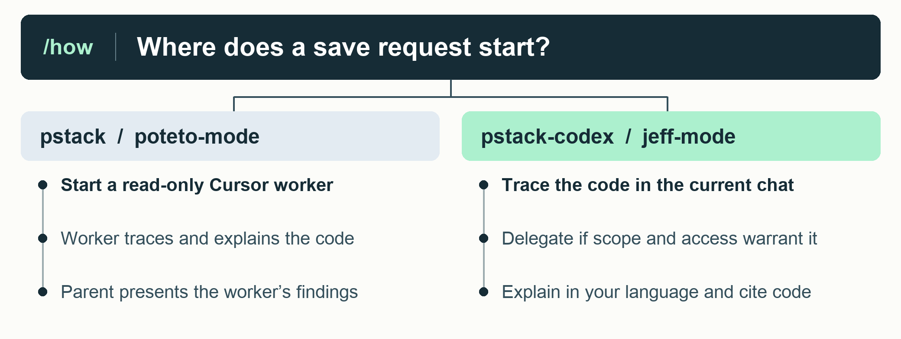

# pstack-codex

[简体中文](README.zh-CN.md)

**Use `jeff-mode` to investigate, design, and verify changes in a Codex project.** This adaptation brings Lauren Tan’s pstack engineering workflows to Codex. It keeps the practice of tracing real code, comparing designs, and verifying the result. The active session supplies the model, the project supplies the checks, and your request determines the deliverable.

## One question, two execution paths

Ask the `how` skill where a save request starts. Upstream pstack assigns that question to a read-only Cursor worker. In pstack-codex, a small trace stays in your current chat. A broader investigation can use an authorized worker. [Compare upstream `how`][up-how] · [Read the Codex version][how]



## What changes from pstack?

The comparison uses [upstream pstack 0.15.44][upstream]. Each row links to the instructions or script behind the behavior.

| Decision | Upstream pstack | pstack-codex |
| --- | --- | --- |
| Who reviews a design? | [Arena][up-arena] defaults to named Claude and Gemini runners and seeks a judge from another vendor. | [Arena][arena] builds independent candidates with the available runners. It records missing coverage when you request a cross-vendor review. |
| Where does yesterday’s context come from? | [Recall][up-recall] looks for JSONL transcripts in Cursor’s project directory. | [Recall][recall] searches the active host’s chats within the requested workspace and time window, then checks findings against Git and PR state. |
| What language does the explanation use? | [Teach][up-teach] asks for plain spoken English. | [Teach][teach] explains the code and design history in the reader’s requested language. |
| What proves a change works? | The [multi-phase plan][up-plan] asks for unit, live, and performance checks for each PR. | The [adapted plan][plan] matches evidence to the change. Exercise the real UI for a user-visible change; measure a baseline and threshold for performance-sensitive work. |
| When does work become a PR? | The [PR playbook][up-pr] calls for a review-ready PR and a `/deslop` pass. | The [adapted playbook][pr] runs when the request or repository calls for a PR. It uses the project’s checks and the requested draft or review-ready state. |
| Can this worktree be retired? | The [audit script][up-audit] uses Git state and recent Cursor transcripts to suggest cleanup candidates. | The [Codex audit][audit] reports Git facts. A clean, merged worktree can still belong to an active chat. The [cleanup playbook][cleanup] checks ownership before using the host’s archive flow. |

## Install and try it

Run these commands in a Codex CLI with plugin marketplace support.

```sh
codex plugin marketplace add JeffreyDeng-spec/pstack-codex
codex plugin add pstack-codex@pstack-codex
```

Open a new chat in your project, type `$`, and select **`pstack-codex:jeff-mode`**. Give it a goal and an observable result. For example:

> Trace the Save button from the click handler to persistent storage. Point me to the code that decides whether the save succeeded. I only need an explanation.

Use a specific skill when you already know the job:

| If you want to… | Select | Ask for |
| --- | --- | --- |
| Understand a design decision | [`teach`][teach] | “Why do we retry here? Show the code and the commit or PR that explains the tradeoff.” |
| Compare two interfaces | [`architect`][architect] | “Sketch both from the caller’s perspective. Use a small prototype to settle the open question.” |
| Stop a recurring regression | [`correct`][correct] | “Find a repeated review finding and add a check that catches a real historical example.” |

The package includes 58 skills and 22 main-workflow playbooks. External services such as Grok Bot need their own configured connection. [Browse the skills][skills] · [Explore the playbooks][playbooks] · [Read the runtime notes][runtime]

## Credits and license

Adapted from [pstack by Lauren Tan][upstream]. Codex adaptation maintained by JeffreyDeng-spec. [MIT License](LICENSE)

[upstream]: https://github.com/cursor/plugins/tree/e58dd043600587dbaf58ba315e7f2b38373eeb43/pstack
[skills]: pstack-codex/skills
[playbooks]: pstack-codex/skills/jeff-mode/playbooks
[runtime]: pstack-codex/docs/harness/codex.md
[how]: pstack-codex/skills/how/SKILL.md
[up-how]: https://github.com/cursor/plugins/blob/e58dd043600587dbaf58ba315e7f2b38373eeb43/pstack/skills/how/SKILL.md
[arena]: pstack-codex/skills/arena/SKILL.md
[up-arena]: https://github.com/cursor/plugins/blob/e58dd043600587dbaf58ba315e7f2b38373eeb43/pstack/skills/arena/SKILL.md
[recall]: pstack-codex/skills/recall/SKILL.md
[up-recall]: https://github.com/cursor/plugins/blob/e58dd043600587dbaf58ba315e7f2b38373eeb43/pstack/skills/recall/SKILL.md
[teach]: pstack-codex/skills/teach/SKILL.md
[up-teach]: https://github.com/cursor/plugins/blob/e58dd043600587dbaf58ba315e7f2b38373eeb43/pstack/skills/teach/SKILL.md
[plan]: pstack-codex/skills/jeff-mode/playbooks/multi-phase-plan.md
[up-plan]: https://github.com/cursor/plugins/blob/e58dd043600587dbaf58ba315e7f2b38373eeb43/pstack/skills/poteto-mode/playbooks/multi-phase-plan.md
[pr]: pstack-codex/skills/jeff-mode/playbooks/opening-a-pr.md
[up-pr]: https://github.com/cursor/plugins/blob/e58dd043600587dbaf58ba315e7f2b38373eeb43/pstack/skills/poteto-mode/playbooks/opening-a-pr.md
[audit]: pstack-codex/skills/jeff-mode/scripts/worktree-audit.sh
[up-audit]: https://github.com/cursor/plugins/blob/e58dd043600587dbaf58ba315e7f2b38373eeb43/pstack/skills/poteto-mode/scripts/worktree-audit.sh
[cleanup]: pstack-codex/skills/jeff-mode/playbooks/worktree-cleanup.md
[architect]: pstack-codex/skills/architect/SKILL.md
[correct]: pstack-codex/skills/correct/SKILL.md
