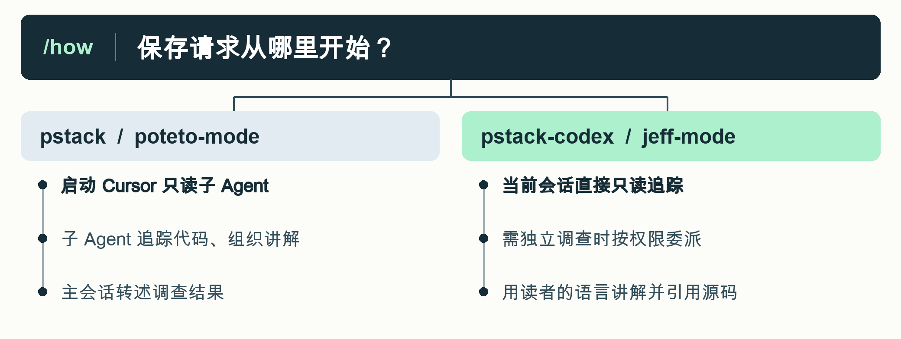

# pstack-codex

[English](README.md)

**用 `jeff-mode` 在 Codex 项目里查代码、比较方案、验证改动。** 插件沿用 Lauren Tan 的 pstack 工程方法。模型默认跟随当前会话，检查使用项目已有的工具，交付形式由你的任务决定。

## 同一个问题，两种执行方式

假设你问 `how`：“点保存后，请求从哪里开始？” 原版 pstack 会启动只读的 Cursor 子 Agent，让它调查后回报。pstack-codex 允许当前会话直接追踪一条短调用链。范围较大、值得独立调查时，再按权限委派。[上游 how][up-how] · [本版 how][how]



## 跟原插件比，哪些决定变了？

下表以 [pstack 0.15.48 的固定提交][upstream] 为基准。两侧链接指向实际的 Skill、剧本或脚本。

| 实际问题 | 原版 pstack | pstack-codex |
| --- | --- | --- |
| 谁来评审方案？ | [arena][up-arena] 默认指定 Claude 和 Gemini 候选模型，并寻找另一家厂商的评委。 | [arena][arena] 让当前可用的模型独立提交候选方案。如果你明确要求跨厂商评审，会记录实际覆盖和缺席的评委。 |
| 怎么接上昨天的工作？ | [recall][up-recall] 从 Cursor 项目目录查找 JSONL 聊天记录。 | [recall][recall] 按工作区和时间查询当前宿主中的聊天，再用 Git 和 PR 状态核对调查结果。 |
| 用什么语言讲解？ | [teach][up-teach] 要求用日常英语解释。 | [teach][teach] 按读者要求选择语言。你可以用中文问设计取舍，并要求给出代码和提交依据。 |
| 什么算验收通过？ | [多阶段计划][up-plan] 给每个 PR 都安排单元、实际运行和性能三类检查。 | [本版计划][plan] 按改动选择证据。改界面就跑用户路径，改性能就测基线、设阈值，仓库规定的检查照常执行。 |
| 什么时候开 PR？ | [PR 剧本][up-pr] 要求调用 `/deslop`，并开可评审的 PR。 | [本版剧本][pr] 按任务和仓库约定决定是否开 PR，使用项目自己的检查，并支持草稿或可评审状态。 |
| 干净的工作树可以清理吗？ | [审计脚本][up-audit] 结合 Git 状态和近期 Cursor 聊天记录给出清理建议。 | [本版脚本][audit] 报告 Git 状态。即使工作树已合并且干净，[清理剧本][cleanup] 仍会核对是否绑定活跃聊天，再按宿主流程归档。 |

## 安装并试用

在支持插件市场的 Codex CLI 中运行：

```sh
codex plugin marketplace add JeffreyDeng-spec/pstack-codex
codex plugin add pstack-codex@pstack-codex
```

在项目里新开一个聊天，输入 `$`，选择 **`pstack-codex:jeff-mode`**。告诉它要完成什么，以及你想看到什么结果。例如：

> 从保存按钮的点击事件一路追到数据落盘，指出哪段代码决定保存成功。这次只需要解释，给我对应的源码位置。

任务明确时，也可以直接选 Skill：

| 你要做什么 | 选择 | 可以这样问 |
| --- | --- | --- |
| 搞懂设计取舍 | [`teach`][teach] | 为什么在这一层做重试？找出当前实现和当初决定这么做的提交或 PR。 |
| 比较两个接口 | [`architect`][architect] | 从调用者视角画两种用法，用一个小原型回答最不确定的问题。 |
| 防止同类错误再次出现 | [`correct`][correct] | 找一个评审里反复提到的问题，写一条能抓住历史错误的检查。 |

`0.15.48+local.1` 提供 59 个 Skill 和 22 个总入口剧本。新增的 [`reframe`](pstack-codex/skills/reframe/SKILL.md) 可以把模糊描述改写成更具体的需求。Grok Bot 等外部服务需要单独配置连接。[全部 Skill][skills] · [工作流剧本][playbooks] · [Codex 适配说明][runtime]

## 来源与许可证

原作是 Lauren Tan 的 [pstack][upstream]，Codex 适配版由 JeffreyDeng-spec 维护。[MIT 许可证](LICENSE)

[upstream]: https://github.com/cursor/plugins/tree/9e278fe4d4ecd8bfe98b1b79bf4be662efb338cc/pstack
[skills]: pstack-codex/skills
[playbooks]: pstack-codex/skills/jeff-mode/playbooks
[runtime]: pstack-codex/docs/harness/codex.md
[how]: pstack-codex/skills/how/SKILL.md
[up-how]: https://github.com/cursor/plugins/blob/9e278fe4d4ecd8bfe98b1b79bf4be662efb338cc/pstack/skills/how/SKILL.md
[arena]: pstack-codex/skills/arena/SKILL.md
[up-arena]: https://github.com/cursor/plugins/blob/9e278fe4d4ecd8bfe98b1b79bf4be662efb338cc/pstack/skills/arena/SKILL.md
[recall]: pstack-codex/skills/recall/SKILL.md
[up-recall]: https://github.com/cursor/plugins/blob/9e278fe4d4ecd8bfe98b1b79bf4be662efb338cc/pstack/skills/recall/SKILL.md
[teach]: pstack-codex/skills/teach/SKILL.md
[up-teach]: https://github.com/cursor/plugins/blob/9e278fe4d4ecd8bfe98b1b79bf4be662efb338cc/pstack/skills/teach/SKILL.md
[plan]: pstack-codex/skills/jeff-mode/playbooks/multi-phase-plan.md
[up-plan]: https://github.com/cursor/plugins/blob/9e278fe4d4ecd8bfe98b1b79bf4be662efb338cc/pstack/skills/poteto-mode/playbooks/multi-phase-plan.md
[pr]: pstack-codex/skills/jeff-mode/playbooks/opening-a-pr.md
[up-pr]: https://github.com/cursor/plugins/blob/9e278fe4d4ecd8bfe98b1b79bf4be662efb338cc/pstack/skills/poteto-mode/playbooks/opening-a-pr.md
[audit]: pstack-codex/skills/jeff-mode/scripts/worktree-audit.sh
[up-audit]: https://github.com/cursor/plugins/blob/9e278fe4d4ecd8bfe98b1b79bf4be662efb338cc/pstack/skills/poteto-mode/scripts/worktree-audit.sh
[cleanup]: pstack-codex/skills/jeff-mode/playbooks/worktree-cleanup.md
[architect]: pstack-codex/skills/architect/SKILL.md
[correct]: pstack-codex/skills/correct/SKILL.md
